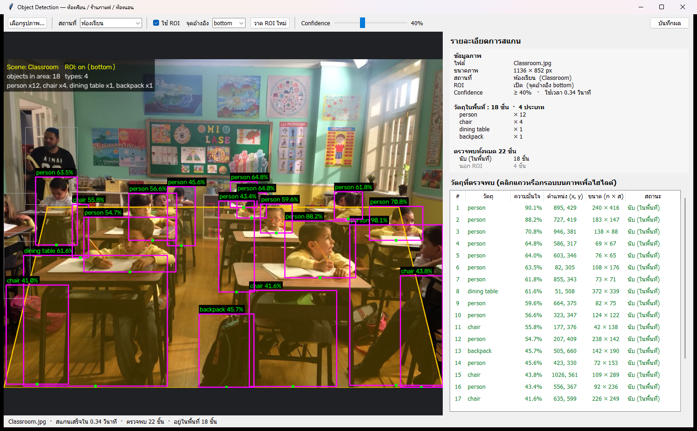
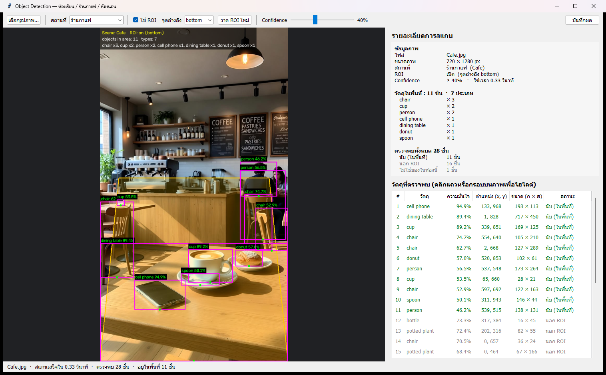
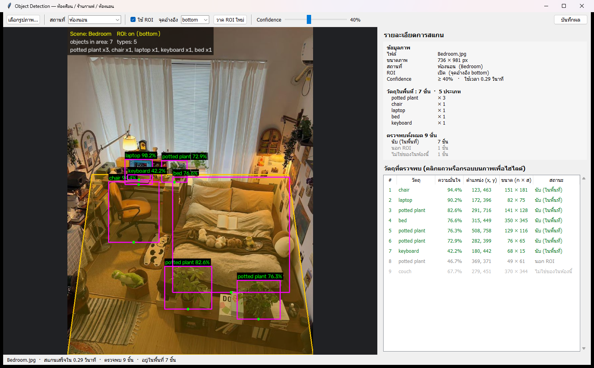

# Object Detection เฉพาะพื้นที่ 3 สถานที่ (Scene Profile + ROI)

ลำดับที่ 17 · ธนวัฒน์ ศรีสง่า · รหัสนิสิต 6830200334

ตรวจจับวัตถุในภาพด้วย **YOLO11n (.onnx) + OpenCV DNN** แล้วกรองผล 2 ชั้น

1. **Scene profile** — เลือกสถานที่ (ห้องเรียน / ร้านกาแฟ / ห้องนอน) แล้วนับเฉพาะคลาสที่ควรพบในสถานที่นั้น
2. **ROI** — นับเฉพาะวัตถุที่จุดอ้างอิงอยู่ในรูปหลายเหลี่ยมที่กำหนดบนภาพ

## วิธีรัน

```
pip install -r requirements.txt
python Project.py
```

เปิดหน้าต่าง GUI → กด **เลือกรูปภาพ…** → โปรแกรมเลือกสถานที่จากชื่อไฟล์ให้อัตโนมัติ แสดงภาพพร้อมกรอบวัตถุ
รายละเอียดการสแกน และตารางวัตถุทุกชิ้น (นับ / นอก ROI / ไม่ใช่ของในห้องนี้) · ไฟล์โมเดลจะดาวน์โหลดเองครั้งแรก

| คำสั่ง | ผล |
|---|---|
| `python Project.py` | เปิด GUI |
| `python Project.py --source pictureForProj/Cafe.jpg` | เปิด GUI พร้อมภาพนี้ |
| `python Project.py --source pictureForProj --no-show` | สแกนทุกภาพในโฟลเดอร์ แล้วบันทึกผลลง `scans/` |
| `python Project.py --source 0` | ใช้กล้องแบบ real-time |

## ผลการรัน

| ภาพ | สถานที่ | วัตถุในพื้นที่ |
|---|---|---|
| Classroom.jpg | ห้องเรียน | person ×12, chair ×4, dining table ×1, backpack ×1 |
| Cafe.jpg | ร้านกาแฟ | chair ×3, cup ×2, person ×2, cell phone ×1, dining table ×1, donut ×1, spoon ×1 |
| Bedroom.jpg | ห้องนอน | potted plant ×3, chair ×1, laptop ×1, bed ×1, keyboard ×1 |




